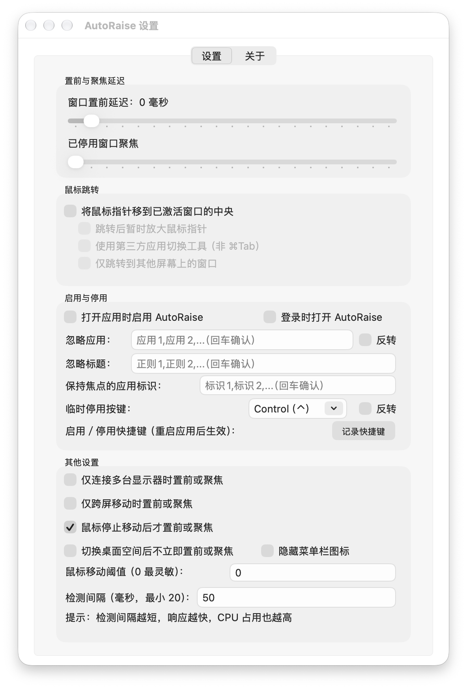

# AutoRaise 简体中文版

鼠标悬停在窗口上时，自动将窗口置于前面并获得焦点；使用 ⌘Tab 或 ⌘` 切换窗口时，也可以让鼠标跳转到激活窗口中央。

本仓库是 **非官方简体中文分支**，基于 [sbmpost/AutoRaise](https://github.com/sbmpost/AutoRaise) 5.7，整合了 [AutoRaise-UI](https://github.com/sbmpost/AutoRaise-UI) 的菜单栏与设置界面。保留原作者 Stefan Post、Lothar Haeger 的署名及许可证。上游英文说明见 [README.en.md](README.en.md)。

## 下载与安装

1. 打开 [最新中文版 Release](https://github.com/iamzjt-front-end/AutoRaise/releases/latest)，下载 `AutoRaise-5.7.1-zh-Hans-universal.dmg`。
2. 打开 DMG，将 `AutoRaise.app` 拖入「Applications（应用程序）」文件夹。
3. 退出旧版 AutoRaise，再从「应用程序」打开新版。
4. 左键点击菜单栏气球图标，按系统提示在「系统设置 → 隐私与安全性 → 辅助功能」中允许 AutoRaise。
5. 左键点击图标可启用／停用；右键点击可打开中文设置或退出。

支持 **macOS 12 及以上**，同一安装包兼容 **Apple Silicon / Intel**。登录时自动打开功能需要 macOS 13 及以上。

安装包使用本地临时签名（ad hoc），没有 Apple Developer ID 签名或公证。如果 macOS 阻止打开，请先确认下载来源，再按系统提示到「系统设置 → 隐私与安全性」允许打开。不要关闭系统整体安全保护。

如果覆盖安装后辅助功能失效，请先退出 AutoRaise，在辅助功能列表中移除旧条目，再添加 `/Applications/AutoRaise.app` 并授权。新版沿用原版应用标识和偏好设置，不能与旧版同时运行。

## 汉化范围

- 菜单栏、设置、关于页面、文本编辑菜单。
- 置前与聚焦延迟、鼠标跳转、应用过滤、多屏选项及输入提示。
- 辅助功能提示、登录项授权提示、重复实例提醒。
- 快捷键录制、冲突提示和无障碍说明。
- 命令行用法、版本信息、权限错误和本说明文档；调试事件日志保留英文，便于向上游反馈。

界面固定使用简体中文。参数名、布尔值、应用名称、正则表达式和配置键保持原格式，兼容原有配置。系统自行显示的权限对话框和错误详情使用系统语言。

## 界面预览



## 设置说明

**置前**会将窗口移到其他窗口前面；**聚焦**将键盘输入焦点交给窗口。聚焦支持沿用上游实验性私有 API，部分应用可能不支持仅聚焦而不置前。

- **置前与聚焦延迟**：滑块最左侧停用对应功能，其余位置按检测间隔递增。
- **鼠标跳转**：切换应用时将鼠标移到目标窗口中央，可选跳转后放大指针或仅跨屏跳转。
- **忽略应用／窗口标题**：使用英文逗号分隔，按回车保存；窗口标题支持 ICU 正则表达式。「反转」将忽略应用改为仅包含这些应用。
- **保持焦点的应用标识**：填写 bundle identifier，例如 `com.apple.screencaptureui`，可避免框选截图时丢失焦点。
- **临时停用按键**：按住 Control 或 Option 时暂停；「不使用」禁用临时停用按键；「反转」后仅按住指定按键时启用。
- **快捷键**：录制全局启用／停用快捷键后重启应用生效。
- **检测间隔**：单位毫秒，最小 20，默认 50；越短响应越快，CPU 占用也越高。
- **鼠标移动阈值**：0 最灵敏；增大后需要更明显的移动才触发。
- **隐藏菜单栏图标**：重新打开应用可恢复图标。

AutoRaise 操作的是 macOS 窗口，不能分别聚焦同一窗口内部的 tmux 或 iTerm 分屏。

## 从源码构建中文版

安装 Xcode 并完成首次启动配置，然后执行：

```sh
git clone https://github.com/iamzjt-front-end/AutoRaise.git
cd AutoRaise
python3 scripts/build-release.py
```

输出为 `build/AutoRaise.app`。构建使用 Xcode 内置编译器、Interface Builder 和资源工具；MASShortcut 2.4.0 源码已随仓库提供，无需 CocoaPods 或额外下载依赖。

```sh
python3 scripts/check-localization.py
python3 scripts/package-release.py
```

打包产物位于 `dist/`，包括 DMG、应用 ZIP 和 SHA-256 校验文件。`scripts/package-release.py` 只本地打包，不上传或发布。

原有 `make` / `make install` 仍用于构建、安装**不带设置界面的核心版本**，不要与上述菜单栏版本混淆。核心支持下列编译选项：

- `OLD_ACTIVATION_METHOD`：为 GTK、SDL、Wine 等部分应用使用旧激活方式，会产生弃用警告。
- `EXPERIMENTAL_FOCUS_FIRST`：启用先聚焦后置前或仅聚焦；依赖私有 API，未来 macOS 可能不再支持。
- `ALTERNATIVE_TASK_SWITCHER`：默认启用第三方应用切换器适配，可能出现意外的鼠标跳转。

中文版安装包启用前两个选项；第三方切换器行为可在界面中配置。

## 命令行与配置文件

核心程序位于 `AutoRaise.app/Contents/Resources/AutoRaise`。可直接执行 `--help` 查看用法，或 `--version` 查看版本；这两个操作不会启动窗口控制服务。

```sh
./build/AutoRaise.app/Contents/Resources/AutoRaise -pollMillis 50 -delay 1 -verbose true
```

核心依次查找 `~/.AutoRaise`、`~/.config/AutoRaise/config`。菜单栏版本另外使用 macOS 偏好设置，并将界面值作为命令行参数传给核心；命令行参数优先。

```ini
# AutoRaise 配置示例
pollMillis=50
delay=1
focusDelay=0
warpX=0.5
warpY=0.5
scale=2.0
warpOnlyAcrossScreens=false
altTaskSwitcher=false
requireMouseStop=true
requireMultipleScreens=false
requireScreenChange=false
ignoreSpaceChanged=false
invertDisableKey=false
invertIgnoreApps=false
ignoreApps="IntelliJ IDEA,WebStorm"
ignoreTitles="^window$"
stayFocusedBundleIds="com.apple.SecurityAgent,com.apple.screencaptureui"
disableKey="control"
mouseDelta=0.1
verbose=false
```

| 参数 | 含义 |
| --- | --- |
| `pollMillis` | 检测间隔，单位毫秒；最小 20，默认 50 |
| `delay` / `focusDelay` | 置前／聚焦延迟；0 停用，1 无延迟，2 等待一个检测间隔，以此类推 |
| `warpX` / `warpY` | 鼠标跳转的横／纵坐标比例，0～1；默认关闭 |
| `scale` | 跳转后指针放大倍数；默认 2.0，1.0 关闭放大 |
| `warpOnlyAcrossScreens` | 仅跨屏跳转，默认 false |
| `altTaskSwitcher` | 使用第三方应用切换工具时设为 true |
| `requireMouseStop` | 鼠标停止后才置前／聚焦，默认 true |
| `requireMultipleScreens` | 仅连接至少两台显示器时置前／聚焦，默认 false |
| `requireScreenChange` | 仅目标窗口与当前焦点窗口不同屏时置前／聚焦，默认 false |
| `ignoreSpaceChanged` | 切换桌面空间后不立即置前／聚焦，默认 false |
| `invertDisableKey` | 反转临时停用按键的作用，默认 false |
| `invertIgnoreApps` | 将忽略列表改为包含列表，默认 false |
| `ignoreApps` | 忽略的应用名，英文逗号分隔 |
| `ignoreTitles` | 忽略的窗口标题或 ICU 正则表达式，英文逗号分隔 |
| `stayFocusedBundleIds` | 不应失去焦点的应用标识，英文逗号分隔 |
| `disableKey` | `control`、`option` 或 `disabled`；默认 `control` |
| `mouseDelta` | 触发所需的鼠标移动距离，0.0 最灵敏 |
| `verbose` | 在终端输出详细调试日志 |

即使未启用 `requireMouseStop`，大于 1 的延迟仍要求鼠标短暂停止。

## 故障排查

确认已退出其他 AutoRaise 实例、辅助功能授权有效，并检查是否有其他鼠标工具干扰。可运行核心并加上 `-verbose true` 收集日志。

汉化与打包问题请提交到 [本仓库 Issues](https://github.com/iamzjt-front-end/AutoRaise/issues)。原版窗口控制问题可参考 [上游核心](https://github.com/sbmpost/AutoRaise)，界面来源见 [AutoRaise-UI](https://github.com/sbmpost/AutoRaise-UI)。

## 许可证与来源

AutoRaise 和 Launcher 使用 GPL-3.0-or-later，见 [LICENSE.md](LICENSE.md)。MASShortcut 使用 BSD 许可证，见 [vendor/MASShortcut/LICENSE](vendor/MASShortcut/LICENSE)。源码来源与固定提交见 [Launcher/UPSTREAM.md](Launcher/UPSTREAM.md) 和 [vendor/MASShortcut/UPSTREAM.md](vendor/MASShortcut/UPSTREAM.md)。
